  

  
  
  

### Open source at [@yielab](https://github.com/yielab)

| Project | What it does | Stack | Status |
|---|---|---|---|
| [**Docket**](https://github.com/yielab/docket) | Governed runtime for coding-agent teams: every tool call passes one policy, approval, budget and audit chokepoint | Python | Public beta |
| [**Tack**](https://github.com/yielab/tack) | Self-hosted project board that dispatches work to Claude Code, Codex or OpenCode through pull-based runners | Rust · SolidJS | Public beta |
| [**Adapta**](https://github.com/yielab/adapta) | Private RAG and model serving: cited hybrid retrieval plus eval-gated LoRA adapters, one OpenAI-compatible endpoint | Python · FastAPI | Beta |
| [**Fabulada**](https://fabulada.com) | Bedtime stories in the family's own dialect, generated by a LangGraph pipeline with deterministic checks | TypeScript · LangGraph | Live, pre-launch |

18 years of client work (Drupal, Symfony, Salesforce, Stripe, SSO, mostly embedded with US agencies) lives in private repositories.
